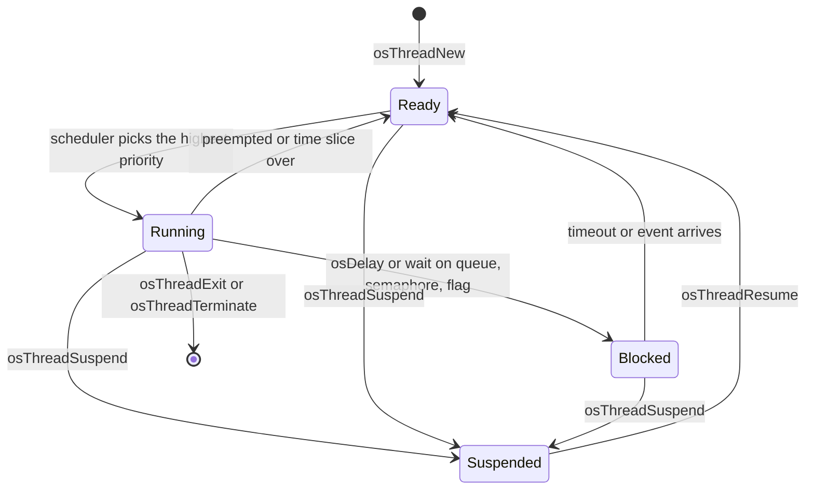
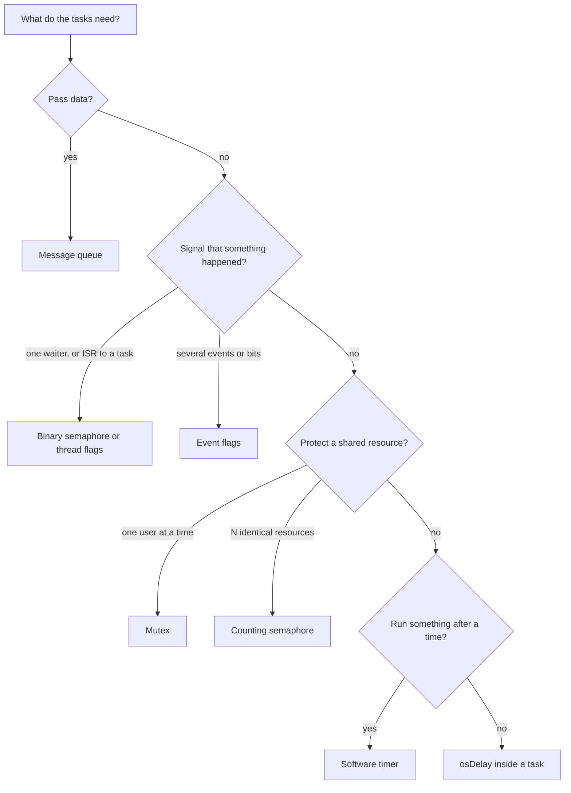
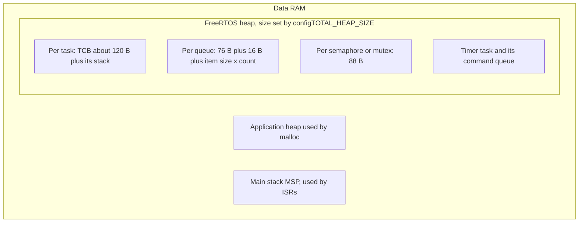
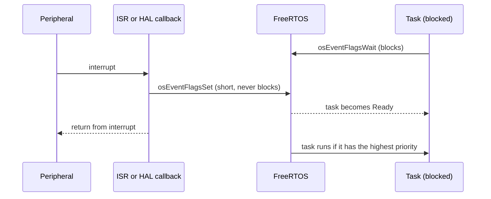

# FreeRTOS on an STM32 board

- **Board:** NUCLEO-H755ZI-Q. It has two processors (a Cortex-M7 and a Cortex-M4).
- **Where my code runs:** only on the **Cortex-M7**. The Cortex-M4 is left at the default settings and does nothing.
- **Tools:** STM32CubeIDE and CubeMX.
- **Output:** `printf` text is sent over USART3 (the USB cable's virtual serial port). Open a serial terminal at **115200 baud, 8N1**.
-**To Replicate** use the code of main.c and related header files in your project.
## The folders

Each folder is a saved copy of the same project at a later stage. Each one has its own README with what it does, what can go wrong and how to fix it.

| Folder | Tutorial part | What it teaches |
|---|---|---|
| `rtos_part1_tasks` | 1 to 3 | Tasks, priorities, and sending messages with a queue |
| `rtos_part2_semaphores` | 4 | Semaphores (tokens that share things fairly) |
| `rtos_part3_mutex` | 5 | Mutexes (a lock with one key) |
| `rtos_part4_event_flags` | 6 | Event flags (raising a flag to wake a task) |
| `rtos_part5_timers` | 7 | Software timers |
| `rtos_part6_stack_overflow` | 8 | Catching a task that uses too much memory |

## Words you will see

| Word | Plain meaning |
|---|---|
| **RTOS** | A small operating system that lets one processor look like it does several jobs at once. |
| **Task** (or thread) | One job, written as a function that loops forever. |
| **Scheduler** | The part of the RTOS that decides which task gets the processor right now. |
| **Priority** | A number saying how important a task is. A more important task that is ready to go runs first. |
| **Blocked** | A task that is waiting (for a delay, a message, a flag) and is not using the processor. |
| **Interrupt / ISR** | A hardware event (like a button press) that makes the processor drop what it is doing and run a short function. |
| **Stack** | A small private memory area each task uses for its local variables. |
| **Heap** | The pool of memory FreeRTOS hands out to tasks, queues and timers. |
| **Tick** | The RTOS clock. Here 1 tick = 1 millisecond. |

## The big picture

### The life of a task

Only one task runs at a time. Out of all the tasks that are ready, the scheduler always picks the most important one. A task that is waiting is *Blocked* and costs nothing.

### Which tool should I use?

### Where FreeRTOS uses memory

Every task, queue, semaphore and timer you create takes memory from the FreeRTOS heap (15 KB in this project). Too many or too big, and creation fails. In the code, a task's stack size is in **bytes** (`128 * 4`), but CubeMX shows it in **words** (1 word = 4 bytes).

### Using FreeRTOS from an interrupt

Good habit: the interrupt only raises a flag or drops a message. The real work happens in a task. Never wait inside an interrupt. Also, an interrupt may only call FreeRTOS if its priority number is **5 or higher** (that is a setting in this project).

## Old and new function names (read before using other tutorials)

Many guides, including the ST training slides, use the **old** version of the API (v1). This project uses the **new** one (v2). They do the same things with different names:

| Job | Old (v1) | New (v2, used here) |
|---|---|---|
| Create a task | `osThreadCreate` | `osThreadNew` |
| Semaphore | `osSemaphoreCreate`, `osSemaphoreWait` | `osSemaphoreNew`, `osSemaphoreAcquire` |
| Mutex | `osMutexCreate`, `osMutexWait` | `osMutexNew`, `osMutexAcquire` |
| Queue | `osMessageCreate`, `osMessagePut/Get` | `osMessageQueueNew`, `osMessageQueuePut/Get` |
| Signal one task | `osSignalSet/Wait` | `osThreadFlagsSet/Wait` |
| Timer | `osTimerCreate` | `osTimerNew` |
| Tick count | `osKernelSysTick` | `osKernelGetTickCount` |
| Stack size unit | words | **bytes** |
| Delays and timeouts | milliseconds | **ticks** (1 tick = 1 ms here) |

If example code from the internet does not compile, check which version it was written for.

## This project's FreeRTOS settings (Cortex-M7)

| Setting | Value | What it means |
|---|---|---|
| Preemption | on | A more important task can interrupt a less important one |
| Tick rate | 1000 Hz | 1 tick = 1 ms |
| Memory for FreeRTOS | 15360 bytes (`heap_4`) | About 15 KB shared by everything |
| Interrupt priority limit | 5 | Interrupts more urgent than 5 (numbers 0 to 4) must **not** call FreeRTOS |
| EXTI3 and USART3 interrupts | priority 5 | Right at the limit, so allowed |
| Timer task | priority 2, 256-word stack | A low-priority helper that runs timer callbacks |
| Stack overflow check | method 2 | Catches most overflows |
| Idle hook | off | Not used |

## Good-to-know points from my course slides (ELE220)

- **CMSIS-RTOS** is a set of rules for function names, not a product. FreeRTOS follows those rules, and so does another OS called RTX, so the same code can run on both.
- **Do you even need an RTOS?** Yes if you have several jobs at once, long interrupt routines, a project that will grow, or a team. No if you only have a few simple jobs. An RTOS costs memory (5 KB and up).
- **Delays:** `HAL_Delay()` makes the processor spin and wait. `osDelay()` puts the task to sleep so other tasks can work.
- **Idle task:** runs when nothing else is ready. You can save power by putting the processor to sleep there (`__WFE()` inside the idle hook).
- **Thread flags:** every task has its own 31 flags, so you can wake one specific task without creating anything.
- **Memory pool:** for big messages, send a pointer instead of copying the data, and always free the block afterwards or the pool runs out.
- **Mutex and interrupts:** an interrupt cannot take a mutex. Use a binary semaphore instead.
- **How the course structures code:** each feature is a module with an init function that creates its task, checks that creation worked, and returns true or false. Use the same shape for Lab 1.

## Problems that can hit any part

| Problem | Fix |
|---|---|
| The debugger loses the board after reset | Set the power supply to `PWR_DIRECT_SMPS_SUPPLY` in CubeMX (from the lab handout) |
| System hangs at start | The HAL clock must use **TIM6**, not SysTick (FreeRTOS owns SysTick) |
| `printf` shows nothing | Check the COM port, 115200 8N1, and the `_write()` function that sends text to the UART |
| Text from different tasks gets mixed | Turn on `configUSE_NEWLIB_REENTRANT` (done), and print from one task where you can |
| Which processor runs my code? | Everything here is on the Cortex-M7, so build and debug the CM7 project |

## About this repository

- Compiled files (`Debug/`, `Release/`) are not stored (see `.gitignore`).
- Open a part in STM32CubeIDE and build both `CM4` and `CM7`.
- The explanations come from the tutorial articles, the ST training slides and my course slides. The problem tables also use what is actually in each project's code. I have not tested any of it on the board myself.
- Known bug: `rtos_part3_mutex` releases the wrong mutex in `functionB()` (details in that folder's README).
- Diagrams are drawn fresh. No slide images were copied.
