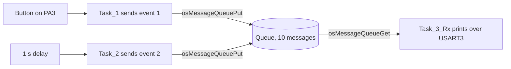

# Part 1: Tasks, Priorities and a Message Queue (tutorial parts 1 to 3)

**Board:** NUCLEO-H755ZI-Q, code on the Cortex-M7. **Serial output:** USART3, 115200 baud, 8N1.

> This folder is the end state of tutorial parts 1 to 3. The earlier LED-blink and priority experiments were overwritten. What is left is the queue project.

## In one sentence
Two tasks drop little messages into a mailbox (a queue), and a third task reads them out and prints them.

## What the project does
- `Task_1` checks a button on **PA3** (pressed = low). On a press it posts "event 1" with the time in milliseconds, then waits 200 ms.
- `Task_2` posts "event 2" with the time in seconds, once every second.
- `Task_3_Rx` (more important than the other two) waits for messages and prints each one.
- The queue holds up to 10 messages.

## Key ideas
- A task is a function that loops forever. It must **wait** somewhere (`osDelay`, or waiting on a queue). A task that never waits hogs the processor and starves less important tasks.
- A queue **copies** each message in, so the sender can reuse its variable right away.
- Waiting times: `0` = don't wait, a number = wait that many ms, `osWaitForever` = wait as long as it takes.
- `osKernelStart()` never comes back. Nothing after it in `main()` runs.

## Problems you may hit, and how to fix them
| Problem | Why | Fix |
|---|---|---|
| Nothing on the terminal | Wrong COM port or speed | Use the ST-Link virtual COM port at 115200 8N1 |
| Board not found, or the debugger drops after reset | Power supply setting on the H755 | Use `PWR_DIRECT_SMPS_SUPPLY` in CubeMX (from the lab handout) |
| System hangs at start | The HAL clock and FreeRTOS both use SysTick | HAL clock on **TIM6** (already done) |
| Printed lines are mixed up | Several tasks printing at once | Turn on `configUSE_NEWLIB_REENTRANT` (done) and print from one task (as here) |
| Messages go missing | `osMessageQueuePut(..., 0)` on a full queue fails quietly | Check the return value, or give it a wait time |
| Button does nothing | PA3 is not the board's button (that is PC13) | Wire a button between PA3 and ground with the pull-up on |
| Crash on the first `printf` | The task's stack is too small | Give the printing task a big stack (this one has 512 words) |

## Memory use (estimate)
By the ST formula (each task about 120 bytes + 4 bytes per stack word; queue 76 + 16 bytes + item size x count): three tasks about 3.4 KB, queue about 0.2 KB, plus about 2 KB for the idle and timer tasks. That is roughly **5.6 KB out of 15 KB**. This is a calculation, not a measurement. To measure, call `xPortGetFreeHeapSize()`.

## Extra tips from the course slides
- `HAL_Delay()` keeps the processor busy and nothing else gets a turn. `osDelay()` lets other tasks run.
- For big messages, put a pointer in the queue instead of the data, and free the block afterwards.
- To save power, the idle task can put the processor to sleep (needs `configUSE_IDLE_HOOK`, off here).

## Things to know about this code
- The two timestamps use **different units** (milliseconds vs seconds). Fine for a demo, confusing in a real project.
- In `Start_Task_2` the `osDelay(20)` after the loop can never run. It is dead code.
- `printf` works through a hand-written `_write()` in `main.c`. It sends one byte at a time and waits for each, so the calling task is held up.
- The helper is named `_io_putchar` (one underscore) while the library's own hook is `__io_putchar` (two). It still works because `_write()` is replaced directly.

## How to check it works
Press the button and a line for event 1 appears. Every second a line for event 2 appears. Both lines come through the same queue.
