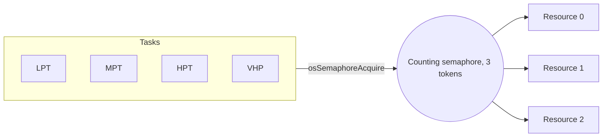

# Part 2: Semaphores (tutorial part 4)

**Board:** NUCLEO-H755ZI-Q, code on the Cortex-M7. **Serial output:** USART3, 115200 baud, 8N1.

## In one sentence
A semaphore is a bag of tokens. To use a shared thing, a task must grab a token first, and give it back when done.

## What the project does
- Four tasks: `LPT` (low importance), `MPT` (medium), `HPT` (high), `VHP` (very high). Each has a 512-word stack.
- A **counting semaphore** with 3 tokens stands for 3 identical resources shared by the 4 tasks. A task takes a token, claims a free slot with `getResource()`, uses it for 2 seconds, then gives everything back.
- `printResourceTable()` prints which task holds which resource.
- A **binary semaphore** (one token) is created too, but its experiments are commented out.

If no token is free, the task waits (Blocked) until another task gives one back.

## Key ideas
- **Binary** semaphore: 0 or 1 token. **Counting** semaphore: up to N tokens.
- In `osSemaphoreNew(max, initial)`, the first number is the most tokens it can hold, the second is how many it starts with.
- A semaphore has **no owner**. Any task may give a token back, even one that never took it. So it does **not** fix "priority inversion" (a medium task slowing down a high one). A mutex does (part 3).
- With 4 tasks and 3 tokens, one task is always waiting. That is normal.

## Problems you may hit, and how to fix them
| Problem | Why | Fix |
|---|---|---|
| A task never runs again | It took a token and never gave it back (for example an early `return`) | Always give the token back on every path |
| Two tasks use the same resource | The semaphore only counts. It does not choose a slot | The slot list (`getResource`) needs its own protection, like a mutex, if two tasks can read it at once |
| A high task seems stuck behind a medium one | A medium task keeps the processor while a low task holds the token | Use a mutex (part 3) |
| A "wait loop" `while(wait--)` takes no time | The compiler deletes an empty loop | Declare the counter `volatile` |
| Creating a task fails | Each 512-word task takes 2 KB of the 15 KB heap | Make stacks smaller, or measure real use (part 6) |
| Print order looks odd | More important tasks cut in | Expected. Keep prints short |

## Memory use (estimate)
Four tasks with 512-word stacks are about 8.7 KB, two semaphores 0.2 KB, plus about 2 KB for the idle and timer tasks. That is roughly **10.9 KB out of 15 KB (about 70 %)**. One more big task would get close to the limit. This is a calculation. Measure with `xPortGetFreeHeapSize()`.

## Extra tips from the course slides
- Use a **binary semaphore to signal** ("something happened") and a **mutex to take turns** with a resource.
- An interrupt can give a token. When you ask for a token you can give a time limit, so you do not have to wait forever. Always check whether you really got it.

## Things to know about this code
- Tasks give the slot back (`release_resource`) **before** returning the token. Keep that order, so nobody can grab a token while the slot still looks busy.
- `VHP` prints its name as `VHPT`. Cosmetic only.

## How to check it works
The resource table should never show one resource owned by two tasks, and at most 3 tasks should hold resources at the same time.
