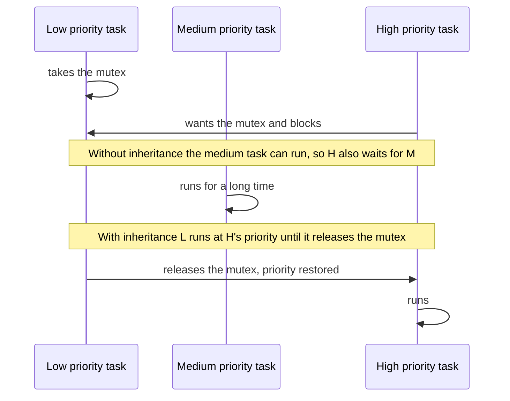

# Part 3: Mutex (tutorial part 5)

**Board:** NUCLEO-H755ZI-Q, code on the Cortex-M7. **Serial output:** USART3, 115200 baud, 8N1.

## In one sentence
A mutex is a lock with a single key. Only the task holding the key may use the shared resource, and only that task may hand the key back.

## What the project does
- Four tasks `LPT`, `MPT`, `HPT`, `VHP` (low to high importance, 512-word stacks). They were used to show "priority inversion" and how a mutex fixes it. Most of that code is commented out now.
- Two mutexes exist: a normal one (`myMutex01`) and a **recursive** one (`myRecursiveMutex01`).
- `LPT` calls `functionB()` every 5 seconds. `functionB()` takes the recursive mutex and then calls `functionA()`, which takes **the same mutex again**. A recursive mutex allows this.

## The classic problem: priority inversion

In plain words: a low task holds the key, a high task is waiting for it, and a medium task keeps hogging the processor, so the low task never gets to finish and the high task is stuck. **Priority inheritance** fixes this by temporarily boosting the key holder to the high task's importance.

## Key ideas
- A mutex has an **owner**. Only the task that took it can release it. (A semaphore has no owner.)
- Priority inheritance: while an important task waits, the holder is boosted so nobody in between can slow it down.
- A normal mutex **freezes** (deadlocks) if its owner tries to take it a second time. A **recursive** mutex keeps a count, and you must release it as many times as you took it.
- An interrupt cannot use a mutex.

## Problems you may hit, and how to fix them
| Problem | Why | Fix |
|---|---|---|
| A task freezes in nested function calls | A normal mutex taken twice by the same task | Use a recursive mutex |
| The mutex stays locked forever | A release is missing, or it was released on the **wrong handle** | Release exactly the mutex you took, once per take |
| `osMutexRelease` returns an error | You released a mutex you do not own | Check the return value (`osErrorResource`) |
| You cannot see the priority problem | The compiler removed your busy loop | Make the loop counter `volatile` |

## Extra tips from the course slides
- **Do not depend on priority inheritance in your design.** It softens the damage but makes timing hard to predict. Design so the problem cannot happen.
- **Deadlock** ("deadly embrace"): two tasks each hold one thing and wait for what the other holds, so both wait forever. Avoid it by always taking several mutexes in the same order.
- **Gatekeeper task:** one task owns a resource (like the UART) and everyone else sends it requests through a queue. No lock, no inversion, no deadlock. This is a good idea for `printf` / MyPrintf.
- Never delete a task that holds a mutex, or the mutex stays locked for everyone.
- Interrupts cannot use mutexes. Use a binary semaphore there.
- Memory: about **10.9 KB out of 15 KB**, like part 2 (calculated estimate).

## Known bug in this code (fix before relying on it)
In `functionB()`, the mutex is taken with `myRecursiveMutex01Handle` but released with **`myMutex01Handle`**. That is the wrong one, so:
- the recursive mutex is never released by `functionB()`, and its count grows by one on every call;
- releasing `myMutex01`, which was never taken, gives an error that nobody checks.

**Fix:** change `osMutexRelease(myMutex01Handle)` in `functionB()` to `osMutexRelease(myRecursiveMutex01Handle)`.

Also, `MPT` declares its busy-wait counter without `volatile` (in the commented-out experiment), so that experiment would not work if you turned it back on.

## How to check it works (after the fix)
Each call prints, in order: B tries to take the mutex, B has it, A tries to take it, A has it, A releases it, B releases it. There is no freeze, and the lock count is back to zero at the end.
