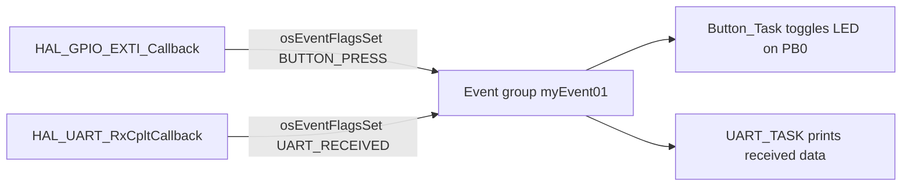

# Part 4: Event Flags (tutorial part 6)

**Board:** NUCLEO-H755ZI-Q, code on the Cortex-M7. **Serial output:** USART3, 115200 baud, 8N1.

## In one sentence
An event flag is a little flag you raise to say "this happened", and a sleeping task wakes up when it sees the flag.

## What the project does
- One group of flags, `myEvent01`.
- `Button_Task` sleeps until the `BUTTON_PRESS` flag is raised, then toggles the LED on **PB0** and waits 500 ms.
- `UART_TASK` sleeps until the `UART_RECEIVED` flag is raised, then prints `received data`.
- The flags are raised from interrupt functions: one for the button, one for the UART having received 5 characters.

In the code, `BUTTON_PRESS` is flag number 3 and `UART_RECEIVED` is flag number 4. The UART function starts the next 5-character receive again, so the task wakes up every time you send 5 characters.

## Key ideas
- A flag group is one 32-bit number where each bit is a separate flag. Only 24 bits are usable (FreeRTOS keeps the top 8).
- `osFlagsWaitAll` wakes the task only when **all** the flags it asked for are raised. `osFlagsWaitAny` wakes it when **any one** of them is raised.
- After a successful wait, the flags are **cleared automatically** unless you ask not to (`osFlagsNoClear`).
- You may raise a flag from an interrupt function.
- The value you get back tells you which flags fired. If the top bit is set, it is an **error code**, not a flag.

## Problems you may hit, and how to fix them
| Problem | Why | Fix |
|---|---|---|
| The UART task wakes only once | `HAL_UART_Receive_IT` receives just one time | Call it again inside `HAL_UART_RxCpltCallback` (this code already does) |
| Nothing happens until you type exactly 5 characters | The receive length is 5 | Type 5 characters, or change the length |
| A task wakes on a flag meant for another | Several tasks wait on the same flag | One flag per task, or use a semaphore if only one task should react |
| A task waits forever | Wrong flag number, or the flag is never raised | Print the returned value, and check the interrupt is enabled |
| The button does nothing | Not wired, or wrong edge | PA3 is not the board's button (that is PC13). Wire one and check the edge setting |
| Crash inside an interrupt function | Calling functions that wait | Only `osEventFlagsSet` (which never waits) belongs there |

## Extra tips from the course slides
- **Thread flags** are an alternative: every task has 31 flags of its own (`osThreadFlagsSet`, `osThreadFlagsWait`). Use them when exactly one known task needs the signal, because you do not have to create a flag group.
- **Interrupt priority matters.** In this project the EXTI3 and USART3 interrupts are at priority 5. An interrupt may only call FreeRTOS if its priority number is **5 or higher**. If you give it a smaller number (more urgent), the system can stop with an error the moment the callback runs.
- Keep interrupt functions short. They only raise a flag. The real work happens in the task.

## Things to know about this code
- `TASK_EVENT_1` to `TASK_EVENT_4` are defined but not used by the two tasks.
- Both tasks use `osFlagsWaitAll` on a single flag, which behaves the same as `osFlagsWaitAny` for one flag.
- `printf` goes through `_write()` over USART3 and waits for every byte.

## How to check it works
Press the button and the LED toggles. Send 5 characters from the serial terminal and `received data` is printed.
