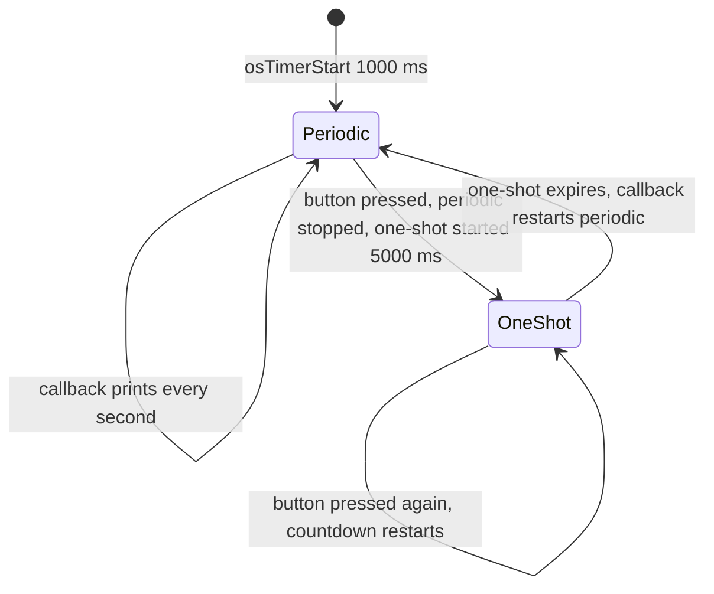

# Part 5: Software Timers (tutorial part 7)

**Board:** NUCLEO-H755ZI-Q, code on the Cortex-M7. **Serial output:** USART3, 115200 baud, 8N1.

## In one sentence
A software timer is an alarm clock: after a set time, FreeRTOS runs a small function for you, with no waiting loop in your own code.

## What the project does
- `Default_Task` (512-word stack) starts a **repeating** timer every 1000 ms, then checks the button on **PA3** every 100 ms.
- The repeating timer's function prints `Data sent from periodic callback`.
- When the button is pressed: the LED on PB0 is switched off, a **one-time** timer is started for 5000 ms, and the repeating timer is stopped.
- When the one-time timer runs out, its function switches the LED on, prints a message, and starts the repeating timer again if it is stopped.

## Key ideas
- A timer runs a **callback** (a function FreeRTOS calls for you) after its time is up.
- Callbacks run inside a hidden helper called the **timer task**, not in an interrupt. Keep them short and never make them wait.
- **Periodic** timers repeat until stopped. **One-shot** timers fire once and must be started again.
- Starting a timer that is already running **restarts** its countdown. That is why repeated button presses extend the one-time timer.
- `configUSE_TIMERS` must be 1 (it is).

## Problems you may hit, and how to fix them
| Problem | Why | Fix |
|---|---|---|
| Crash or garbage when a callback prints | `printf` needs lots of stack and the timer task's stack is small | Raise `configTIMER_TASK_STACK_DEPTH`, or raise a flag and print from a normal task |
| Other tasks seem frozen | Slow or waiting code inside a callback | Callbacks must finish quickly |
| The timer never fires | It was never started, or the time is 0 | Check `osTimerStart(handle, ms)` and its return value |
| The timer fires late | The timer task has a low priority | Check the timer task priority |
| The one-time timer keeps extending while you hold the button | The button is checked every 100 ms and each check restarts it | React to the moment of pressing, not to the button being held |

## Your settings and extra tips
- The timer task here has **priority 2**, a **256-word (1 KB) stack** and a command queue of 10. Priority 2 is lower than your normal tasks, so a timer can fire late when they are busy.
- A `printf` inside a callback uses that 1 KB stack. If the callback grows, raise the stack size.
- The ST slides even show `osDelay()` inside a callback as a bad example.
- Software timers are not exact. For precise timing, use a hardware timer.
- Memory: one 512-word task plus the timer objects is about **4.3 KB out of 15 KB** (calculated estimate).

## Things to know about this code
- The LED logic is the **opposite of the tutorial's**: it goes off when you press the button and on when the one-time timer ends. That is fine if you meant it. Check it matches the LED behaviour you want.
- The button on PA3 is read as "pressed = low". It is not the board's own button.

## How to check it works
With no input, a line prints every second. After a button press, the lines stop for 5 seconds, then the one-time message appears and the lines start again.
