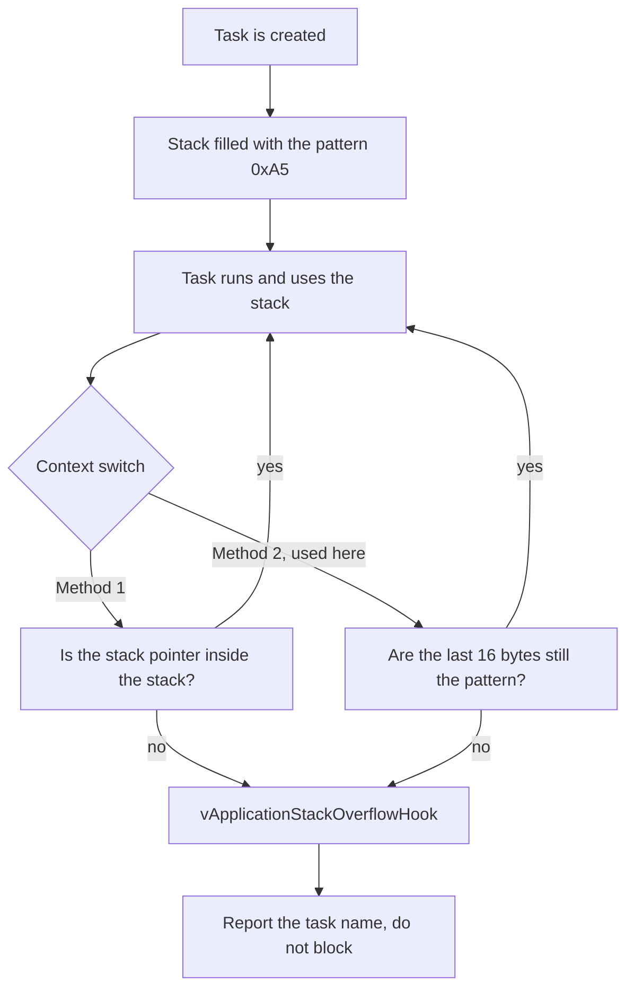

# Part 6: Stack Use and Overflow Detection (tutorial part 8)

**Board:** NUCLEO-H755ZI-Q, code on the Cortex-M7. **Serial output:** USART3, 115200 baud, 8N1.

## In one sentence
Every task has a small private memory area (its stack). If a task uses more than it has, it silently damages the memory next to it. This part shows how to measure that and how to get warned.

## What the project does
- Three worker tasks with different stack sizes: `Task1` (128 words), `Task02` (256 words), `Task03` (526 words). A fourth task, `monitor_Task` (512 words, low importance), reports how much stack each has left using `osThreadGetStackSpace()`.
- `Task1` prints a message every 2 seconds and has a `uint32_t dat[55]` array (220 bytes) to use up some of its stack.
- Settings: `configCHECK_FOR_STACK_OVERFLOW = 2`, `INCLUDE_uxTaskGetStackHighWaterMark = 1`, and a `vApplicationStackOverflowHook()` function in `freertos.c`. FreeRTOS calls this hook when it finds an overflow. The file also declares `huart3`, so the hook can write to the UART.

In plain words: FreeRTOS fills each new stack with a known pattern. If that pattern at the far end of the stack gets overwritten, the task has used too much.

## Key ideas
- An overflow does **not** crash right away. It quietly corrupts nearby memory, so the crash appears somewhere unrelated.
- The **high water mark** is the *least* free stack a task has ever had. It can only go down, so it shows the minimum safe size.
- `printf` uses a lot of stack **no matter how short the text is**.
- Stack use changes with the compiler's optimisation and with how deep functions call each other. So **measure it**, do not guess.
- Method 1 only checks the stack pointer at a task switch: fast, but misses some overflows. Method 2 also checks the pattern: slower, catches more. Neither catches everything.

## Problems you may hit, and how to fix them
| Problem | Why | Fix |
|---|---|---|
| Random crashes (hard faults) | A stack overflow somewhere | Turn on overflow checking and read the high water marks |
| The hook never runs | `configCHECK_FOR_STACK_OVERFLOW` is 0 | Set it to 2 (done here) |
| Hook output is garbled or missing | `printf` is unsafe inside the hook | Send text with `HAL_UART_Transmit` directly (the tutorial approach) |
| Stack sizes seem 4x off | CubeMX shows **words**, the code shows **bytes** (`128 * 4`) | 1 word = 4 bytes. `osThreadGetStackSpace` returns bytes |
| A big local array has no effect | The compiler throws away unused variables | Actually use the array, or make it `volatile` |
| Creating tasks fails, or the system crashes at start | The 15 KB FreeRTOS heap is used up | Shrink stacks, or raise `configTOTAL_HEAP_SIZE` |

## How to choose a stack size (from the ST slides)
1. Start with a big stack (for example 4 KB).
2. Run the task through its busiest path.
3. Read `uxTaskGetStackHighWaterMark()`.
4. Set the stack to *what it used* + a safety margin.

Other notes:
- The high water mark needs `configUSE_TRACE_FACILITY 1` and `INCLUDE_uxTaskGetStackHighWaterMark 1` (the second is on here).
- The hook must not wait (`osDelay`, `while(1)`). The tutorial stops the system there on purpose. In a real product you would log the problem and restart.
- Memory for this part: four tasks (1422 words in total) about 6.2 KB plus about 2 KB for system tasks, roughly **8.2 KB out of 15 KB** (calculated estimate).

## Things to know about this code
- `Task03` has a 526-word stack. That is probably a typo for 512. Harmless, but check.
- 128 words is tight for a task that calls `printf`. That is the point of the demo.
- This part reuses the `printf` setup from part 1 (the `_write()` function over USART3).

## How to check it works
The monitor prints how much stack each task has left. If you make a task's stack too small, or add a bigger local array, the free space drops toward 0 and finally the hook is called with the guilty task's name.
